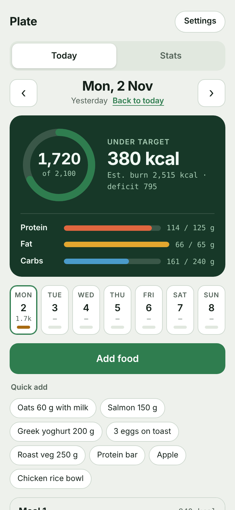
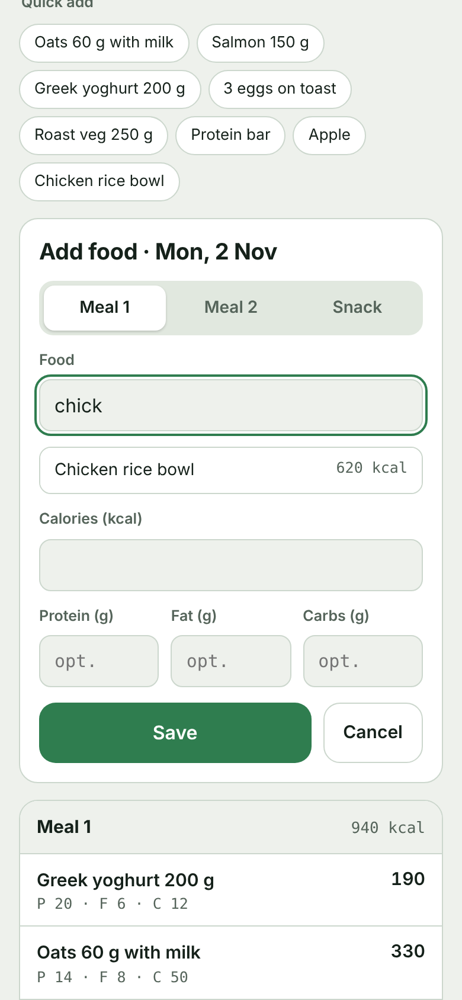
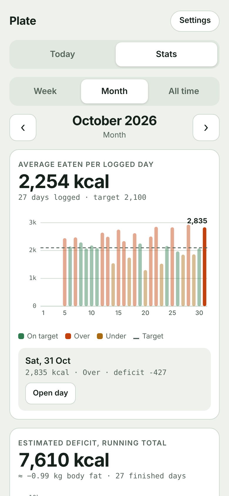
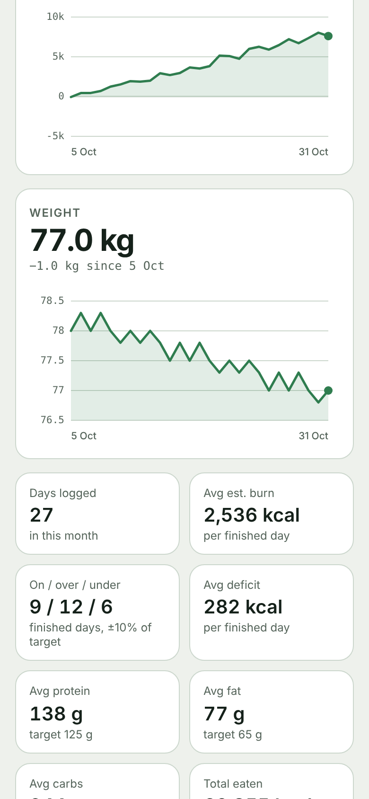
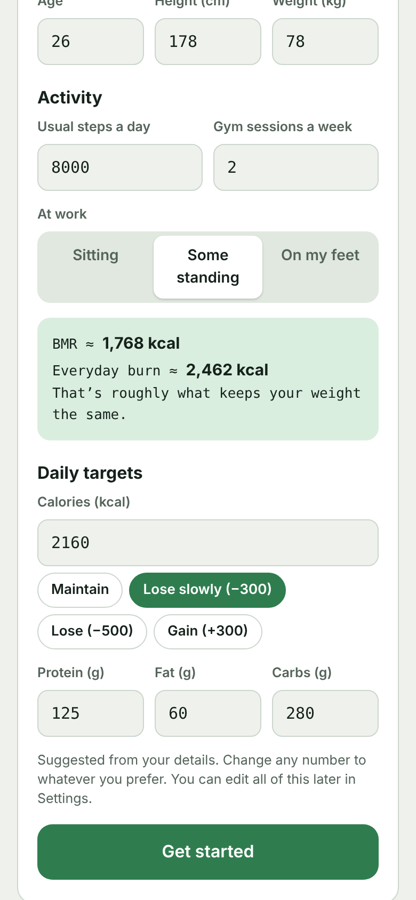

<p align="center">
  
</p>

<h1 align="center">Plate</h1>

<p align="center">
  Log what you eat, hit your calorie and macro targets, and see your estimated deficit.<br>
  A small web app that installs on your phone like a normal app. No account, no server.
</p>

<p align="center">
  <a href="https://omerfauzan.github.io/plate/"><b>Open Plate</b></a>
</p>

---

## Why I made this

A friend was tracking everything in a spreadsheet: every food, calories, protein, fat and carbs, plus a sheet estimating how much he burns each day. It worked, but filling in a spreadsheet on a phone after every meal is a pain. So I turned it into an app that does the same maths, is quick to log in, and works for anyone.

## Screenshots

| Today | Adding food | Stats | Trends | Setup |
|---|---|---|---|---|
|  |  |  |  |  |

<sub>Screenshots use made-up sample data.</sub>

## What it does

**Today**
- A calorie ring against your daily target, how much is left (or how much you're over), and bars for protein, fat and carbs.
- Estimated calories burned that day and your deficit.
- Foods grouped into Meal 1, Meal 2 and Snack. Tap any food to edit it.
- Looking at a past day? Copy a whole meal to today in one tap.
- A Mon to Sun strip coloured by how each day went: on target, over or under.
- Weight, steps and gym for the day, which feed into the burn estimate.

**Logging food**
- Start typing and it suggests foods you've logged before, with their calories and macros filled in.
- Quick-add buttons for the foods you eat most.
- Macros are optional, so calories-only entries are fine.

**Stats**
- Week, month and all-time views.
- Calories eaten against target as a bar chart. Tap a bar to see that day or week and jump to it.
- Running estimated deficit, and a weight trend once you log weight.
- Days logged, days on target / over / under, average burn, average deficit, and average protein, fat and carbs against your targets.
- A 7-day rolling average over the monthly chart, and a smoothed 7-day weight trend with your actual weigh-ins as dots.
- Where your calories come from (% protein / fat / carbs) next to your target split.
- Average calories by day of the week, and your top foods by calories.

**Worth a look**
- Plate points out things that need attention, each tagged Check, Note or Good:
  - days you didn't log (they skew averages)
  - big days over 130% of target
  - macros running well over or under target
  - weekends running higher than weekdays
  - how much of your intake has no macros logged
  - your estimated weekly pace in kg
- **Scale check:** once you have a few weigh-ins over 10+ days, it compares your real weight trend with the estimated deficit. If they're far apart, it tells you so, since the burn settings may need adjusting or something isn't getting logged.
- Tap an insight to jump to the day it's about. The most important ones also show up on the Today screen.

**Estimates you can see into**
- Every estimated number is marked "est". Tap the burn on the Today screen to see exactly how it's worked out (base, standing, steps, gym) with your numbers, and a shortcut to adjust them.

**Setup and settings**
- On first open it asks for your details and activity, then works out your BMR and everyday burn.
- It suggests targets to maintain, lose or gain. You can change any of them.
- Everything can be changed later in Settings, including a button to recalculate your BMR when your weight changes.

## How the numbers work

| What | How it's worked out |
|---|---|
| BMR | Mifflin-St Jeor: 10 × weight + 6.25 × height − 5 × age, + 5 for men or − 161 for women |
| Everyday burn | BMR × 1.2 + extra for standing at work + (steps − 3,000) × kcal per step + gym |
| kcal per step | About 0.0005 × body weight in kg |
| Gym | Your session burn on days you mark "Trained", 0 on rest days, otherwise your weekly average spread over 7 days |
| Status | Over if you eat more than 110% of target, under if less than 90%, otherwise on target |
| Deficit | Estimated burn minus what you ate. Today only counts once the day is over |
| Fat change | Total deficit ÷ 7,700 kcal per kg (rule of thumb) |

All the burn and fat numbers are estimates, roughly ±10%. They're useful for spotting trends, not exact.

## Install it on your phone

**iPhone**
1. Open [omerfauzan.github.io/plate](https://omerfauzan.github.io/plate/) in **Safari**.
2. Tap **Share**, then **Add to Home Screen**.

**Android**
1. Open the link in **Chrome**.
2. Tap **⋮**, then **Add to Home screen** (or **Install app**).

## Your data

Everything is saved in your phone's browser storage and never leaves your phone. So:

- If you clear Safari's website data or delete the app's data, your log goes with it.
- Use **Backup and restore** at the bottom of the app now and then. **Copy backup** gives you a block of text to keep in Notes or send to yourself.
- To move to a new phone, or to start from a backup, tap **Already use Plate? Restore a backup instead** on the welcome screen and paste it in.

## How it's built

No frameworks and no build step, just plain HTML, CSS and JavaScript.

| File | What it does |
|---|---|
| `index.html` | The whole app: layout, styles and logic |
| `sw.js` | Service worker that caches the app so it opens instantly and works offline |
| `manifest.webmanifest` | Lets phones install it as an app (name, colours, icons) |
| `icon-180.png`, `icon-192.png`, `icon-512.png` | App icons |
| `docs/screenshots/` | Images for this README |

- Data is stored in `localStorage` under keys starting with `plate-`.
- Charts are plain SVG, with no chart library.
- Light and dark mode follow the phone's setting by default. Tap the sun/moon button at the top, or pick Auto / Light / Dark in Settings, to choose one yourself.

## Run it locally

The service worker needs a real server, so don't open the file directly:

```bash
git clone https://github.com/Omerfauzan/plate.git
cd plate
python3 -m http.server 8000
```

Then open http://localhost:8000.

## Updating

If you change `index.html`, bump the `CACHE` name in `sw.js` (for example `plate-v3` to `plate-v4`). Otherwise phones keep showing the cached old version. After pushing, close and reopen the app twice to pick up the update.

---

Made by [Omer Fauzan](https://github.com/Omerfauzan).
